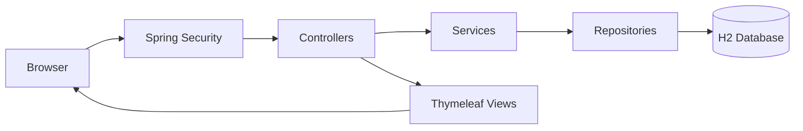
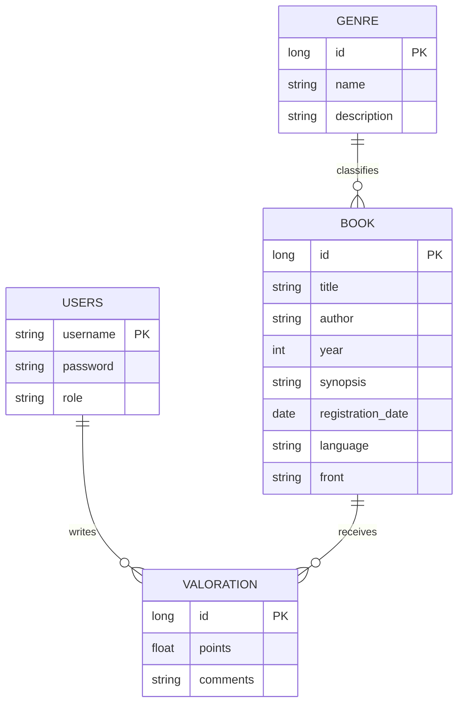

<div align="center">

# 📚 Book-Advisor

**Discover, rate and share your next favourite book.**

A server-rendered book catalogue built with **Spring Boot 3**, **Thymeleaf** and **Spring Security**.

[](https://openjdk.org/)
[](https://spring.io/projects/spring-boot)
[](https://www.thymeleaf.org/)
[](https://spring.io/projects/spring-security)
[](https://www.h2database.com/)
[](https://getbootstrap.com/)

[Overview](#-overview) · [Features](#-features) · [Tech stack](#-tech-stack) · [Getting started](#-getting-started) · [Routes](#-main-routes) · [Roadmap](#-roadmap)

</div>

---

## 📖 Overview

**Book-Advisor** is a web application where readers can explore a curated book catalogue, rate books and share reviews, while managers keep the collection and its genres up to date.

The project was developed as part of the **Web Development in Server Environments** course (UDAW2) and follows a classic layered Spring architecture: controllers, services, repositories, JPA entities and DTOs, secured with Spring Security and rendered server-side with Thymeleaf and Bootstrap.

It is a complete example of a small Spring Boot application with authentication, role-based authorization, form validation, file uploads and a responsive UI.

---

## ✨ Features

### 🌐 Public area

- Landing page with project highlights and calls to action.
- About and contact pages.
- Book catalogue with cover thumbnails, title, author, genre, language and average rating.
- Search panel to filter the catalogue.
- Genre overview.
- Sign-up, login and logout.

### ⭐ Registered readers

- Rate books from **0 to 10**.
- Write or update a review — each reader has at most one review per book.
- See the community average rating and the number of votes.

### 🛠️ Managers and administrators

- Create, edit and delete books.
- Upload book covers with a live image preview.
- Create, edit and delete genres.
- Moderate and delete reviews.

### 🔐 Security and quality

- Passwords hashed with **BCrypt**.
- Role-based authorization at the URL level.
- **CSRF** protection.
- Server-side validation with Jakarta Bean Validation.
- Custom **403**, **404**, **500** and access-denied pages.
- Responsive Bootstrap 5 interface with Bootstrap Icons.

---

## 🧰 Tech stack

| Layer | Technology |
| --- | --- |
| Language | Java 21 |
| Framework | Spring Boot 3.5.5 |
| Web | Spring MVC + Thymeleaf |
| Persistence | Spring Data JPA + Hibernate |
| Database | H2 (in-memory) |
| Security | Spring Security 6 (form login, BCrypt, roles) |
| Validation | Jakarta Bean Validation |
| UI | Bootstrap 5.3 + Bootstrap Icons |
| Build | Maven Wrapper |
| Utilities | Lombok, Spring Boot DevTools |

---

## 🏗️ Architecture

The application follows a layered MVC design:

- **Controllers** receive HTTP requests, bind form data to DTOs and populate the model.
- **Services** contain business logic and transaction boundaries.
- **Repositories** are Spring Data JPA interfaces.
- **Domain entities** map the object model to the H2 schema.
- **Thymeleaf templates** render HTML, styled with Bootstrap.
- **Spring Security** filters every request and enforces role rules before controllers run.



---

## 🚀 Getting started

### Prerequisites

- **Java 21** or newer
- **Git**
- Maven is **not** required — the Maven Wrapper is included.

### Clone and run

```bash
git clone https://github.com/alejandro-lago/Book-Advisor.git
cd Book-Advisor
./mvnw spring-boot:run
```

On Windows:

```bash
mvnw.cmd spring-boot:run
```

Then open **http://localhost:9000** in your browser.

### Build an executable JAR

```bash
./mvnw clean package
java -jar target/myapp-0.0.1-SNAPSHOT.jar
```

### Run the tests

```bash
./mvnw test
```

---

## 👤 Demo accounts

Demo genres and users are seeded automatically on startup. Because the database is in-memory, all data is recreated every time the application starts.

| Role | Username | Password |
| --- | --- | --- |
| `ADMIN` | `jefe` | `algo` |
| `MANAGER` | `algo` | `algo` |

New accounts created from the **Sign-Up** page receive the `USER` role.

> These credentials are intended for local development only.

---

## ⚙️ Configuration

The main settings live in `src/main/resources/application.properties`:

| Setting | Default | Notes |
| --- | --- | --- |
| `server.port` | `9000` | HTTP port |
| `spring.thymeleaf.cache` | `false` | Templates are reloaded during development |
| Database | H2 in-memory | Recreated on every start |
| Uploads | `./uploads` | Cover images, served at `/uploads/**` |
| H2 console | Disabled | Enable with `spring.h2.console.enabled=true`; `/h2-console/**` is restricted to `ADMIN` |

---

## 🗺️ Main routes

| Area | Method | Path | Access |
| --- | --- | --- | --- |
| Home | `GET` | `/public/home` | Public |
| About | `GET` | `/public/who` | Public |
| Contact | `GET` / `POST` | `/public/contact`, `/public/contact/submit` | Public |
| Catalogue | `GET` | `/public/book` | Public |
| Catalogue filter | `GET` | `/public/book/filter` | Public |
| Genres | `GET` | `/public/genre` | Public |
| Sign up | `GET` / `POST` | `/public/signup`, `/public/signup/submit` | Public |
| Book details | `GET` | `/book/{id}` | `USER`, `MANAGER`, `ADMIN` |
| Add book | `GET` / `POST` | `/book/new`, `/book/new/submit` | `MANAGER`, `ADMIN` |
| Edit book | `GET` / `POST` | `/book/edit/{id}`, `/book/edit/submit` | `MANAGER`, `ADMIN` |
| Delete book | `GET` | `/book/delete/{id}` | `MANAGER`, `ADMIN` |
| Reviews | `GET` | `/book/valoration/{id}` | `USER`, `MANAGER`, `ADMIN` |
| Add / update review | `GET` / `POST` | `/book/valoration/new/{id}`, `/book/valoration/new/submit` | `USER`, `MANAGER`, `ADMIN` |
| Delete review | `GET` | `/valoration/delete/{id}` | `MANAGER`, `ADMIN` |
| Genre management | `GET` / `POST` | `/genre/**` | `MANAGER`, `ADMIN` |
| Login | `GET` | `/login` | Public |
| Logout | `POST` | `/logout` | Authenticated |

---

## 🛡️ Roles and permissions

| Capability | `USER` | `MANAGER` | `ADMIN` |
| --- | :---: | :---: | :---: |
| Browse the public catalogue | ✅ | ✅ | ✅ |
| Rate and review books | ✅ | ✅ | ✅ |
| Add, edit and delete books | ❌ | ✅ | ✅ |
| Manage genres | ❌ | ✅ | ✅ |
| Delete reviews | ❌ | ✅ | ✅ |
| Access the H2 console (if enabled) | ❌ | ❌ | ✅ |

---

## 🗃️ Data model



- A **book** belongs to one **genre** and can receive many **reviews**.
- A **review** links one **user** to one **book** with a rating and optional comments.
- A **user** is identified by a unique username and has one of three roles: `USER`, `MANAGER` or `ADMIN`.

---

## 📂 Project structure

```text
Book-Advisor/
├── src/main/java/com/example/myapp/
│   ├── Main.java                  # Entry point + demo data seeding
│   ├── configuration/             # Security, MVC and UserDetails configuration
│   ├── controllers/               # Public and model controllers
│   ├── domain/                    # JPA entities
│   ├── dtos/                      # Form-backing and view DTOs
│   ├── enums/                     # Role, Language and Consult enums
│   ├── repositories/              # Spring Data JPA interfaces
│   └── services/                  # Business logic
├── src/main/resources/
│   ├── application.properties
│   └── templates/                 # Thymeleaf views
├── src/test/                      # Spring Boot context test
├── uploads/                       # Uploaded book covers
├── mvnw / mvnw.cmd                # Maven Wrapper
└── pom.xml
```

---

## 🧭 Roadmap

- [ ] Persist data with PostgreSQL or MySQL and add Flyway migrations.
- [ ] Add profile pages: my reviews, edit profile and change password.
- [ ] Admin user management.
- [ ] Pagination, sorting and richer search.
- [ ] Replace GET-based delete actions with `POST`/`DELETE` and CSRF tokens.
- [ ] Add a `Dockerfile` and Docker Compose setup.
- [ ] Add integration tests for controllers and security rules.
- [ ] Send contact-form messages by email.

### Known limitations

- The H2 database is in-memory, so data does not survive a restart.
- The contact form validates input but does not send an email yet.
- Some navigation items (Users/Profile) are UI placeholders.
- Seeded users and credentials are intended for development only.

---

## 👨‍💻 Author

**Alejandro Lago**

- GitHub: [@alejandro-lago](https://github.com/alejandro-lago)
- Repository: [Book-Advisor](https://github.com/alejandro-lago/Book-Advisor)

---

## 📄 License

This project was developed for educational purposes. If you would like to reuse or build on it, please contact the author.

<div align="center">

**Built with ☕ and Spring Boot.**

</div>
